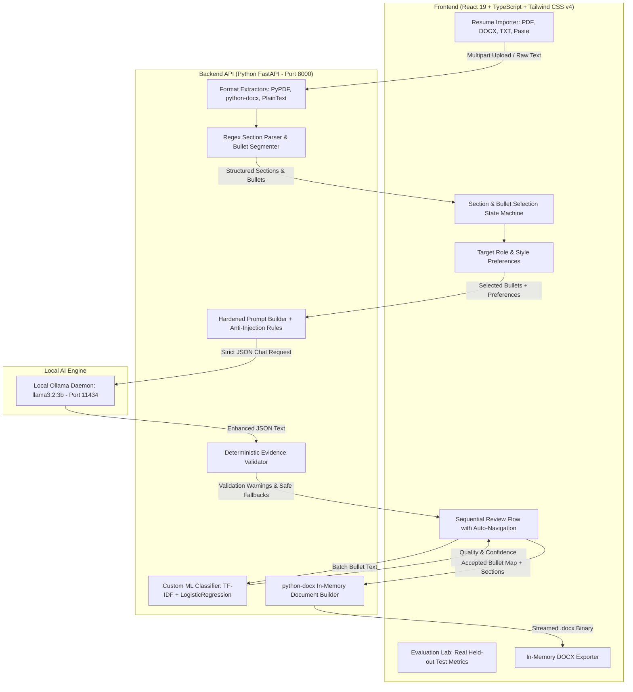

# BulletBoost — AI-Powered Resume Bullet-Point Enhancer

[](https://www.python.org/)
[](https://fastapi.tiangolo.com/)
[](https://react.dev/)
[](https://www.typescriptlang.org/)
[](https://tailwindcss.com/)
[](https://scikit-learn.org/)
[](https://github.com/)

**BulletBoost** is an executive-grade resume bullet enhancer engineered for ambitious job seekers who want impactful, role-tailored resume bullets **without fabricating metrics, credentials, or technologies**.

Unlike conventional generative AI tools that hallucinate statistics (e.g. inventing *"boosted revenue by 43%"* or *"reduced latency by 80%"* without factual basis), BulletBoost implements a **Three-Layer AI & Anti-Hallucination Architecture**:
1. **Local Generative LLM** (Ollama `llama3.2:3b`): Enhances active voice, professional syntax, and role alignment while operating completely on your local machine for total privacy.
2. **Deterministic Evidence Validator**: Rule-based Python regex and entity-matching engine that cross-references proposed improvements against original bullets and candidate facts, strictly flagging or withholding ungrounded numbers, unauthorized skills, or inflated ownership claims.
3. **Custom-Trained ML Quality Classifier** (`TF-IDF + Logistic Regression`): An independent quality benchmark trained on 183 hand-labeled bullets, providing side-by-side quality ratings (`Weak` → `Adequate` → `Strong`) with empirical confidence ratings evaluated on held-out test data.

---

> [!NOTE]
> **Complete Technical Guide Available**: For an in-depth breakdown of every backend service, regex pattern, data structure, React component, state transition, and training pipeline, see [PROJECT_EXPLANATION.md](file:///c:/Resume%20Bullet-Point%20Enhancer/PROJECT_EXPLANATION.md).

---

## Table of Contents

- [System Architecture](#system-architecture)
- [Key Features](#key-features)
- [Three-Layer AI & Validation System](#three-layer-ai--validation-system)
- [Custom ML Classifier & Held-Out Evaluation](#custom-ml-classifier--held-out-evaluation)
- [API Reference](#api-reference)
- [Quickstart & Local Setup](#quickstart--local-setup)
- [Automated Testing Suite (130 Tests)](#automated-testing-suite-130-tests)
- [Live Demonstration Workflow](#live-demonstration-workflow)
- [Responsible AI & Limitations](#responsible-ai--limitations)
- [Project Structure](#project-structure)

---

## System Architecture



---

## Key Features

### 1. Robust Multi-Format Document Parsing
- **Format Support**: In-memory parsing of `.pdf` (via `pypdf`), `.docx` (via `python-docx`), `.txt`, and direct copy-pasted text.
- **Header & Structure Recognition**: Automatically recognizes 10 standard resume sections (*Summary, Work Experience, Internships, Projects, Education, Skills, Certifications, Achievements, Publications, Other*).
- **Date Pattern Exclusion**: Prevents role titles and employment date ranges (e.g., *"June 2022 – Present"*) from being incorrectly categorized as section headings.
- **Continuition Line Merging**: Automatically reconstructs multi-line bullet points wrapped across paragraphs.

### 2. Deterministic Anti-Hallucination Evidence Validation
- **Numerical & Metric Verification**: Normalized token extraction detects any new digits, percentages, monetary amounts, or multipliers not present in the candidate's original text or scoped supporting facts.
- **Technology Entity Matching**: Cross-checks 60+ common technical keywords (e.g., *React, Docker, Kubernetes, Celery, Redis, PyTorch*) to block the editor from inventing tools the candidate did not use.
- **Domain-Scoped Supporting Facts**: Prevents background evidence from unrelated projects leaking into different bullets.
- **Ownership Escalation Protection**: Prevents modest contributions (*"assisted with"*, *"contributed to"*) from being inflated into unearned leadership claims (*"architected"*, *"spearheaded"*).
- **Targeted Corrective Retry**: If Ollama produces an ungrounded claim or malformed JSON, a targeted corrective prompt runs (at most one retry). If violations persist, invalid suggestions are safely withheld (`improved: null`, status `review_needed`) to protect the candidate.

### 3. Custom-Trained ML Quality Classifier
- **Pipeline Architecture**: `TfidfVectorizer(ngram_range=(1,2), sublinear_tf=True)` combined with `LogisticRegression(C=2.0, class_weight='balanced')`.
- **Dataset**: 183 hand-curated and annotated resume bullets evaluated on a held-out test split (Seed 42), achieving **75.7% accuracy** and **100% recall on strong bullets**.
- **Live Reclassification**: Re-evaluates edited bullet points in real time as the candidate modifies them in the browser.
- **Empirical Confidence**: Real model probability displayed side-by-side with prediction badges (flagging classifications under 50% as uncertain).

### 4. Sequential Review State Machine
- **Guided Single-Item Focus**: An auto-advancing review sequence (`findNextPendingBulletId`) smoothly guides users through bullet suggestions.
- **Granular Decisions**: Accept, reject, or inline-edit any bullet with instant keyboard and button shortcuts.
- **No-Op Detection (`isCandidateNoOp`)**: Detects identical text, whitespace variations, and superficial formatting changes, properly marking them as `no_suggestion` and preventing artificial quality score inflation.

### 5. Professional DOCX Resume Export
- **In-Memory Generation**: Streams clean `.docx` Word documents directly from memory with zero temporary files left on disk.
- **Selective Substitution**: Replaces **only user-accepted bullets**; rejected and unedited bullets preserve their exact original wording and formatting.
- **Executive Styling**: Standard 0.75-inch margins, modern Calibri typography, and customized section divider borders.

---

## Three-Layer AI & Validation System

| Layer | Technology | Purpose | Safety & Anti-Hallucination Defenses |
| :--- | :--- | :--- | :--- |
| **Layer 1: Generative LLM** | Ollama (`llama3.2:3b`) | Rewrites bullets with active verbs, clarity, and role alignment | Hardened system prompts; strict JSON schema; inputs treated as untrusted data; targeted corrective retry |
| **Layer 2: Deterministic Validator** | Python Regex & Tokenizer | Rule-based factual claim verification | Flags or withholds unverified numbers, percentages, technologies, and ungrounded leadership claims |
| **Layer 3: Machine Learning Classifier** | Scikit-learn (`TF-IDF + LogisticRegression`) | Independent quality benchmark (`Weak` / `Adequate` / `Strong`) | Evaluates linguistic strength and structure on held-out empirical data; never acts as factual verifier |

---

## Custom ML Classifier & Held-Out Evaluation

The custom quality classifier was trained on `backend/data/bullet_quality_dataset.csv` (183 labeled samples) using a stratified 80/20 train/test split (Seed 42).

### Global Test Split Performance

| Metric | Held-Out Test Set (20% Split) | Training Set (80% Split) |
| :--- | :---: | :---: |
| **Accuracy** | **75.68%** | 94.52% |
| **Macro Precision** | **76.81%** | 95.12% |
| **Macro Recall** | **76.07%** | 94.38% |
| **Macro F1-Score** | **75.21%** | 94.70% |

### Per-Class Test Split Breakdown

| Quality Tier | Precision | Recall | F1-Score | Support (Samples) |
| :--- | :---: | :---: | :---: | :---: |
| **Weak** | 0.8889 | 0.6154 | 0.7273 | 13 |
| **Adequate** | 0.6154 | 0.6667 | 0.6400 | 12 |
| **Strong** | **0.8000** | **1.0000** | **0.8889** | 12 |

### Held-Out Test Confusion Matrix

```
                 Predicted Weak    Predicted Adequate    Predicted Strong
Actual Weak            8                   5                    0
Actual Adequate        1                   8                    3
Actual Strong          0                   0                   12
```

> **Key Takeaway**: The classifier achieved **100% recall (12/12) on Strong bullets** and **zero false positives for Strong bullets originating from Weak inputs**. Strong bullets are never misclassified as Weak.

---

## API Reference

The backend exposes a RESTful API powered by FastAPI. Interactive documentation is available at `http://127.0.0.1:8000/docs`.

### Core Endpoints

| Method | Endpoint | Description | Request Body | Response |
| :--- | :--- | :--- | :--- | :--- |
| `GET` | `/api/health` | Service health status | None | `HealthResponse` |
| `POST` | `/api/parse-resume` | Multipart file upload (.pdf, .docx, .txt) | `multipart/form-data` | `ParseResumeResponse` |
| `POST` | `/api/parse-resume-text` | Raw text segmenter | `ParseTextRequest` | `ParseResumeResponse` |
| `GET` | `/api/ollama/status` | Ollama connectivity & model presence | None | `OllamaStatusResponse` |
| `POST` | `/api/enhance-bullets` | LLM rewrite & evidence validation | `EnhanceBulletsRequest` | `EnhanceBulletsResponse` |
| `POST` | `/api/classify-bullets` | Batch ML quality scoring | `ClassifyBulletsRequest` | `ClassifyBulletsResponse` |
| `GET` | `/api/evaluation/metrics` | Real held-out test evaluation report | None | `EvaluationMetricsResponse` |
| `GET` | `/api/classifier/status` | Classifier model artifact status | None | `ClassifierStatusResponse` |
| `POST` | `/api/export-docx` | Stream in-memory .docx resume | `ExportDocxRequest` | `.docx` Binary Stream |

---

## Quickstart & Local Setup

### Prerequisites

- **Python 3.10+** (with `pip`)
- **Node.js 18+** (with `npm`)
- **Ollama** (optional for live local LLM inference; automatic demo fallback is included)

---

### Method A: Automated 1-Click Startup (PowerShell)

The recommended way to start BulletBoost on Windows:

```powershell
.\start_local.ps1
```

The startup script handles everything automatically:
1. Validates Python 3.10+ and Node.js 18+ prerequisites.
2. Checks backend dependencies (`fastapi`, `uvicorn`, `pydantic`, `pypdf`, `python-docx`, `scikit-learn`, `joblib`, `pandas`, `numpy`) and frontend `node_modules`.
3. Verifies that the ML classifier artifact exists (automatically trains if missing).
4. Detects local Ollama status on port 11434 and checks for `llama3.2:3b`.
5. Verifies port 8000 availability (reusing healthy instances or reporting conflicts).
6. Starts the FastAPI server and polls `http://127.0.0.1:8000/api/health` until confirmed healthy.
7. Starts the Vite frontend and prints direct URLs.

---

### Method B: Manual Setup

#### 1. Backend Setup

```powershell
# Navigate to project root
cd "c:\Resume Bullet-Point Enhancer"

# Install backend dependencies
pip install -r backend/requirements.txt

# Train the reproducible classifier (generates model artifact and evaluation report)
python backend/scripts/train_classifier.py

# Start the FastAPI server
python -m uvicorn backend.app.main:app --host 127.0.0.1 --port 8000 --reload
```

#### 2. Frontend Setup

```powershell
# In a separate terminal from project root
npm install
npm run dev
```

Visit **`http://localhost:5173`** in your browser.

#### 3. Optional: Ollama Setup (For Local LLM Inference)

```powershell
# Start Ollama service
ollama serve

# Pull the lightweight model in another terminal
ollama pull llama3.2:3b
```

*Note: If Ollama is not running, BulletBoost automatically offers an intelligent, client-side heuristic mode with zero hallucinated metrics, ensuring the complete user workflow remains fully functional.*

---

## Automated Testing Suite (130 Tests)

BulletBoost includes a comprehensive test suite of **130 automated tests** covering backend endpoints, extraction boundaries, evidence validation, ML classification, and frontend state machines:

```powershell
# 1. Run all 105 backend PyTest tests
python -m pytest backend/tests -v

# 2. Run all 25 frontend Node.js regression & integration tests
npm test

# 3. Verify TypeScript types
npx tsc -b

# 4. Run fast oxlint linter
npx oxlint
```

### Test Coverage Highlights
- **`test_p0_identical_text_regression.py`**: Ensures identical input/output text produces `no_suggestion`, withholds explanations, and prevents artificial quality uplift.
- **`test_p0_low_ml_confidence_pipeline.py`**: Verifies that low classifier confidence is distinguished from category predictions and does not suppress legitimate suggestions.
- **`test_quality_regression.py`**: Tests rejection of repeated metric hallucinations, outcome claims (*throughput, latency, overhead*), and duplicated verbs.
- **`test_validator.py`**: Tests deterministic regex and entity checking for numbers, tools, and ownership inflation.
- **`test_export.py`**: Tests in-memory DOCX generation, filename sanitization, and partial acceptance substitutions.
- **`test_extractors.py`**: Verifies PDF magic bytes (`%PDF-`), DOCX zip structure (`PK\x03\x04`), 10 MB upload limits, and scanned document detection.

---

## Live Demonstration Workflow

Follow this step-by-step checklist during a demonstration:

1. **Verify Services**:
   - Check `http://127.0.0.1:8000/api/health` returns `{"status": "ok", "app": "BulletBoost API"}`.
   - Open `http://localhost:5173` in your browser.
2. **Resume Import**:
   - Click **Try Sample Resume** (or upload `test_resume.pdf` / `test_resume.txt`).
   - Observe automatic section segmentation, word counts, and bullet extraction.
3. **Section Selection**:
   - Select **Work Experience** and **Projects**; deselect unneeded sections.
4. **Target Preferences**:
   - Set Target Role: `Senior Machine Learning Engineer`.
   - Set Writing Style: `Technical` or `Achievement`.
   - Add Supporting Fact: `Optimized SQL reporting queries, reducing query execution time from 5 minutes to 30 seconds`.
5. **Generation & Evidence Validation**:
   - Click **Enhance Selected Bullets**.
   - Notice that supported facts are safely incorporated, while unsupported claims display distinct amber warning badges.
6. **Machine Learning Quality Comparison**:
   - Compare the **Original vs. Proposed** quality badges (`Weak` → `Strong`) and observe real model confidence ratings.
7. **Sequential Review & Real-Time ML Reclassification**:
   - Click **Edit** on a bullet to alter the text.
   - Watch the ML classifier reclassify the bullet **live** upon saving!
   - Click **Accept**; observe how the review state machine smoothly advances to the next pending item (`findNextPendingBulletId`).
8. **Export Approved Resume**:
   - Advance to **Final Review** and click **Export Resume (DOCX)**.
   - Open the generated `.docx` file in Microsoft Word or LibreOffice.
   - Confirm that **only accepted bullets were substituted**, while original section titles and formatting remain intact.
9. **Evaluation Lab Inspection**:
   - Click **Evaluation Lab** in the navigation bar.
   - Inspect the interactive confusion matrix, class distribution, and held-out test split metrics loaded from `backend/models/evaluation_report.json`.

---

## Responsible AI & Limitations

- **Linguistic Quality, Not Hiring Prediction**: The custom ML classifier evaluates sentence structure, conciseness, and action verbs. It does **not** evaluate candidate qualifications or predict hiring decisions.
- **Human-in-the-Loop Mandate**: No text is ever substituted into the candidate's resume without explicit human review and acceptance.
- **Local Privacy**: With Ollama operating locally, resume data never leaves the candidate's personal computer.
- **Hallucination Mitigation**: While the deterministic validator intercepts unverified metrics, tools, and ownership claims, candidates are always encouraged to review bullet points for full factual accuracy.

---

## Project Structure

```
c:\Resume Bullet-Point Enhancer\
├── backend/
│   ├── app/
│   │   ├── main.py                     # FastAPI application entrypoint & CORS setup
│   │   ├── config.py                   # Environment configuration & paths
│   │   ├── models.py                   # Pydantic v2 schemas for all requests & responses
│   │   ├── routers/
│   │   │   ├── health.py               # Health check endpoint (/api/health)
│   │   │   ├── parser.py               # Document & text parsing endpoints
│   │   │   ├── ollama.py               # Ollama connectivity status endpoint
│   │   │   ├── enhancer.py             # LLM bullet enhancement endpoint
│   │   │   ├── classifier.py           # ML quality prediction & evaluation endpoints
│   │   │   └── exporter.py             # In-memory DOCX resume exporter endpoint
│   │   └── services/
│   │       ├── extractors.py           # PyPDF, python-docx, and plain text extractors
│   │       ├── section_parser.py       # Rule-based regex section & bullet segmenter
│   │       ├── prompt_builder.py       # Hardened system prompts & corrective retry prompts
│   │       ├── validator.py            # Deterministic evidence & metric validator
│   │       ├── ollama_service.py       # Ollama chat orchestrator with retry & fallback
│   │       ├── classifier_service.py   # Cached scikit-learn classifier service
│   │       └── exporter.py             # python-docx resume builder & filename sanitizer
│   ├── data/
│   │   └── bullet_quality_dataset.csv  # 183 hand-curated labeled resume bullets
│   ├── models/
│   │   ├── bullet_classifier.joblib    # Serialized scikit-learn Pipeline artifact
│   │   └── evaluation_report.json      # Persisted held-out test split metrics
│   ├── scripts/
│   │   └── train_classifier.py         # Reproducible training & evaluation pipeline
│   └── tests/                          # 105 PyTest backend integration & unit tests
├── src/
│   ├── components/
│   │   ├── enhance/
│   │   │   ├── ResumeImport.tsx        # Drag-and-drop file upload & text paste
│   │   │   ├── SectionAnalysis.tsx     # Section tree with granular checkboxes
│   │   │   ├── EnhancementPreferences.tsx # Target role, style, and evidence input
│   │   │   ├── ResultsReview.tsx       # Sequential review, inline editor & export
│   │   │   └── StepIndicator.tsx       # Multi-step progress bar
│   │   ├── layout/                     # Layout, Header, and Footer components
│   │   └── ui/                         # Buttons, Badges, and Input primitives
│   ├── context/
│   │   └── AppContext.tsx              # Central reducer & state machine
│   ├── pages/
│   │   ├── LandingPage.tsx             # Hero page with feature highlights
│   │   ├── EnhancePage.tsx             # Enhancement wizard container
│   │   ├── EvaluationPage.tsx          # Interactive ML Evaluation Lab
│   │   └── AboutPage.tsx               # System architecture & status
│   ├── services/
│   │   ├── api.ts                      # Frontend HTTP client & error handler
│   │   └── heuristicEnhancer.ts        # Client-side fallback enhancement engine
│   ├── utils/
│   │   └── review.ts                   # findNextPendingBulletId review navigation
│   └── types.ts                        # TypeScript type definitions
├── tests/                              # 25 Node.js frontend tests
├── start_local.ps1                     # Automated PowerShell startup launcher
├── README.md                           # Project overview & quickstart
└── PROJECT_EXPLANATION.md              # Exhaustive technical explanation document
```

---

## License

Built for demonstration, educational, and portfolio purposes.
