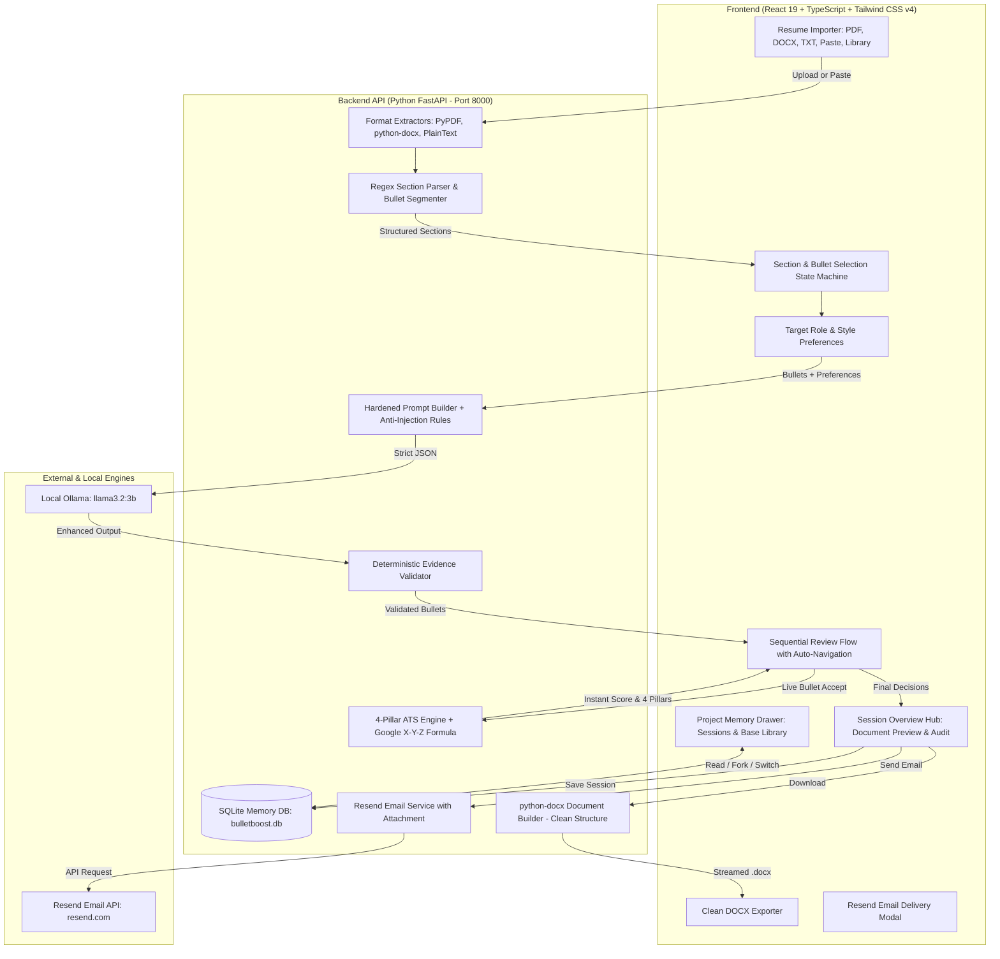

# BulletBoost — AI-Powered Resume Bullet-Point Enhancer & ATS Engine

[](https://www.python.org/)
[](https://fastapi.tiangolo.com/)
[](https://react.dev/)
[](https://www.typescriptlang.org/)
[](https://tailwindcss.com/)
[](https://www.sqlite.org/)
[](https://resend.com)
[](https://scikit-learn.org/)
[](https://github.com/phadshubham/BulletBoost)

**BulletBoost** is an executive-grade resume bullet enhancer and ATS optimization platform engineered for ambitious job seekers who want impactful, role-tailored resume bullets **without fabricating metrics, credentials, or technologies**.

Unlike conventional generative AI tools that hallucinate statistics (e.g. inventing *"boosted revenue by 43%"* or *"reduced latency by 80%"* without factual basis), BulletBoost implements a **Multi-Layer AI, Real-Time ATS Scoring, & Anti-Hallucination Architecture**:
1. **Industry-Standard ATS Scoring Engine**: 4-pillar evaluation (**Keywords 40%**, **Impact 30%**, **Brevity 15%**, **Structure 15%**), 500+ modern skills catalog, alias mapping, Google X-Y-Z formula checking, and context-aware metric vs. date filtering.
2. **Local Generative LLM** (Ollama `llama3.2:3b`): Enhances active voice, professional syntax, and role alignment while operating completely on your local machine for total privacy (with built-in heuristic fallback).
3. **Deterministic Evidence Validator**: Rule-based Python regex and entity-matching engine that cross-references proposed improvements against original bullets and candidate facts, strictly flagging or withholding ungrounded numbers, unauthorized skills, or inflated claims.
4. **Persistent Memory Hub & Resume Library**: Local SQLite database auto-saving sessions, forking tailored resume variants for different companies, and preserving a library of uploaded base resumes for 1-click re-use.
5. **Automated Resend Email Delivery**: Auto-drafts cover note emails and delivers the enhanced `.docx` resume attachment directly via the Resend API.
6. **Custom-Trained ML Quality Classifier** (`TF-IDF + Logistic Regression`): An independent benchmark trained on 183 hand-labeled bullets, providing side-by-side quality ratings (`Weak` → `Adequate` → `Strong`).

---

## Table of Contents

- [System Architecture](#system-architecture)
- [Key Features](#key-features)
- [Industry-Standard ATS Scoring Engine](#industry-standard-ats-scoring-engine)
- [Persistent Memory & Revision History](#persistent-memory--revision-history)
- [Automated Email Delivery via Resend](#automated-email-delivery-via-resend)
- [Three-Layer AI & Validation System](#three-layer-ai--validation-system)
- [Custom ML Classifier & Held-Out Evaluation](#custom-ml-classifier--held-out-evaluation)
- [API Reference](#api-reference)
- [Quickstart & Local Setup](#quickstart--local-setup)
- [Automated Testing Suite (144 Tests)](#automated-testing-suite-144-tests)
- [Live Demonstration Workflow](#live-demonstration-workflow)
- [Responsible AI & Limitations](#responsible-ai--limitations)
- [Project Structure](#project-structure)

---

## System Architecture



---

## Key Features

### 1. Industry-Standard Real-Time ATS Scoring Engine
- **4 Weighted Pillars**:
  - **Keywords & Technical Alignment (40%)**: Scored against job descriptions or target role skills using a 500+ skill taxonomy with alias/synonym mapping (e.g. `k8s` ↔ `kubernetes`, `aws` ↔ `amazon web services`).
  - **Impact & Quantification (30%)**: Evaluates Tier-1 action verbs, quantifiable metrics, and Google X-Y-Z formula compliance (*Accomplished [X] as measured by [Y], by doing [Z]*).
  - **Brevity & Readability (15%)**: Audits line length, syllable complexity, and eliminates corporate clichés (*"hardworking"*, *"team player"*, *"results-driven"*).
  - **Structure & Formatting (15%)**: Evaluates standard section presence and machine readability.
- **Context-Aware Metric Filtering**: Smart regex discards calendar years (1970–2099), dates, software versions, and single digits to prevent false metric inflation.
- **Instant Debounce (150ms)**: Dual-maps accepted bullet rewrites by both ID and text; the overall ATS score recalculates live as you accept improvements.
- **Positive Impact Indicators**: Replaced arbitrary point jumps with clean `✨ Positively Affects ATS Score` badges.

### 2. Persistent Memory Hub & Uploaded Resume Library
- **Dedicated Session Overview Hub**: Loading a saved session opens a full-page command center displaying chosen preferences, live ATS scores, execution summaries, and a document preview.
- **Uploaded Resume Library**: Browse all previously uploaded base resumes with bullet counts and dates; start fresh optimizations with 1 click without re-uploading files.
- **Multi-Role Variant Forking**: Fork an existing resume session into new tailored variants for different companies or job targets with independent decision trees.
- **Local SQLite Database**: 100% private, local SQLite storage (`backend/data/bulletboost.db`) with automatic schema migrations.

### 3. Automated Resend Email Delivery
- **Instant Dispatch**: Send enhanced `.docx` resumes as email attachments directly from the app via the official Resend API.
- **Auto-Drafted Cover Notes**: Generates role-tailored email copy with optional personal messages.
- **Interactive Delivery Modal**: Available in both Final Review and the Session Overview Hub.

### 4. Clean DOCX Resume Export
- **Exact Document Structure Preserved**: Streams formatted `.docx` Word documents directly from memory replacing only accepted bullets.
- **Zero Title Injection**: The file title is used exclusively for the filename — never inserted as an artificial 18pt heading inside the document body.
- **Executive Styling**: Standard 0.75-inch margins, modern Calibri typography, and clean section borders.

### 5. Deterministic Anti-Hallucination Evidence Validation
- **Numerical & Metric Verification**: Token extraction checks that every number, percentage, or dollar amount exists in the source text or verified supporting facts.
- **Technology Entity Matching**: Cross-checks 60+ technical keywords to prevent inventing tools the candidate never used.
- **Ownership Escalation Protection**: Prevents modest contributions (*"assisted with"*) from being inflated into unearned leadership claims (*"architected"*).

---

## API Reference

The backend exposes a RESTful API powered by FastAPI. Interactive documentation is available at `http://127.0.0.1:8000/docs`.

### Core Endpoints

| Method | Endpoint | Description |
| :--- | :--- | :--- |
| `GET` | `/api/health` | Service health status |
| `POST` | `/api/parse-resume` | Multipart file upload (`.pdf`, `.docx`, `.txt`) |
| `POST` | `/api/parse-resume-text` | Raw text segmenter |
| `GET` | `/api/ollama/status` | Ollama connectivity & model presence |
| `POST` | `/api/enhance-bullets` | LLM rewrite & evidence validation |
| `POST` | `/api/ats/score-resume` | Composite 4-pillar ATS scoring with accepted bullet substitutions |
| `POST` | `/api/ats/score-bullet` | Individual bullet ATS delta evaluation |
| `POST` | `/api/ats/jd-gap` | Job description keyword gap analysis |
| `POST` | `/api/classify-bullets` | Batch ML quality scoring |
| `GET` | `/api/evaluation/metrics` | Held-out test evaluation report |
| `GET` | `/api/classifier/status` | Classifier model artifact status |
| `POST` | `/api/export-docx` | Stream in-memory `.docx` resume |
| `POST` | `/api/send-resume` | Automated resume delivery via Resend API |
| `GET` | `/api/projects` | List all saved resume optimization sessions |
| `GET` | `/api/projects/{id}` | Retrieve full project session detail |
| `POST` | `/api/projects` | Create a new saved project session |
| `PUT` | `/api/projects/{id}` | Update an existing project session |
| `POST` | `/api/projects/{id}/fork`| Fork project into a new tailored role variant |
| `DELETE` | `/api/projects/{id}` | Delete a project session |
| `GET` | `/api/projects/library/resumes` | List uploaded base resumes in the library |

---

## Quickstart & Local Setup

### Prerequisites

- **Python 3.10+** (with `pip`)
- **Node.js 18+** (with `npm`)
- **Ollama** (optional for local LLM inference; automatic heuristic fallback included)
- **Resend API Key** (optional for live email delivery; get a free key at [resend.com](https://resend.com))

---

### Method A: Automated 1-Click Startup (PowerShell)

The recommended way to start BulletBoost on Windows:

```powershell
.\start_local.ps1
```

The startup script handles everything automatically:
1. Validates Python 3.10+ and Node.js 18+ prerequisites.
2. Checks backend dependencies and frontend `node_modules`.
3. Verifies that the ML classifier artifact exists (automatically trains if missing).
4. Detects local Ollama status on port 11434 and checks for `llama3.2:3b`.
5. Starts the FastAPI server (`http://127.0.0.1:8000`) and Vite frontend (`http://localhost:5173`).

---

### Method B: Manual Setup

#### 1. Backend Setup

```powershell
# Navigate to project root
cd "c:\Resume Bullet-Point Enhancer"

# Install backend dependencies
pip install -r backend/requirements.txt

# Train the ML quality classifier
python backend/scripts/train_classifier.py

# Configure environment variables (create backend/.env)
# RESEND_API_KEY=your_key_here
# RESEND_FROM_EMAIL=onboarding@resend.dev

# Start the FastAPI server
python -m uvicorn backend.app.main:app --host 127.0.0.1 --port 8000 --reload
```

#### 2. Frontend Setup

```powershell
# In a separate terminal from project root
npm install
npm run dev
```

Visit **`http://localhost:5173`** in your browser.

#### 3. Optional: Ollama Setup (For Local LLM Inference)

```powershell
# Start Ollama service
ollama serve

# Pull the lightweight model in another terminal
ollama pull llama3.2:3b
```

---

## Automated Testing Suite (144 Tests)

BulletBoost includes a comprehensive test suite of **144 automated tests** covering backend endpoints, ATS scoring, Resend email delivery, extraction boundaries, evidence validation, ML classification, and frontend state machines:

```powershell
# 1. Run all 119 backend PyTest tests
$env:PYTHONPATH="." ; python -m pytest backend/tests -v

# 2. Run all 25 frontend Node.js regression & integration tests
npm test

# 3. Verify TypeScript build
npm run build
```

### Test Coverage Highlights
- **`test_email.py`**: Tests invalid email handling, missing API keys, mocked Resend dispatch, Resend sandbox restriction messaging, and optional bullet IDs.
- **`test_ats_scorer.py`**: Tests 4-pillar calculation, metric vs date filtering, Google X-Y-Z formula checking, and dynamic keyword extraction.
- **`test_projects_db.py`**: Tests SQLite project persistence, auto-migrations, library endpoints, and session forking.
- **`test_export.py`**: Tests in-memory DOCX generation, filename sanitization, and verifies that the filename never appears inside the document body.
- **`test_p0_identical_text_regression.py`**: Ensures identical input/output text produces `no_suggestion`, withholds explanations, and prevents artificial quality uplift.
- **`test_validator.py`**: Tests deterministic regex and entity checking for numbers, tools, and ownership inflation.

---

## Responsible AI & Limitations

- **Linguistic Quality & ATS Alignment, Not Hiring Guarantee**: The ATS scoring engine and classifier evaluate sentence structure, keyword alignment, and metric density. They do **not** guarantee interviews or evaluate candidate fitness.
- **Human-in-the-Loop Mandate**: No text is ever substituted into the candidate's resume without explicit human review and acceptance.
- **Local Privacy**: With Ollama and SQLite operating locally, resume data never leaves the candidate's personal computer.
- **Hallucination Mitigation**: While the deterministic validator intercepts unverified metrics, tools, and ownership claims, candidates are always encouraged to review bullet points for full factual accuracy.

---

## License

Built for demonstration, educational, and portfolio purposes.
